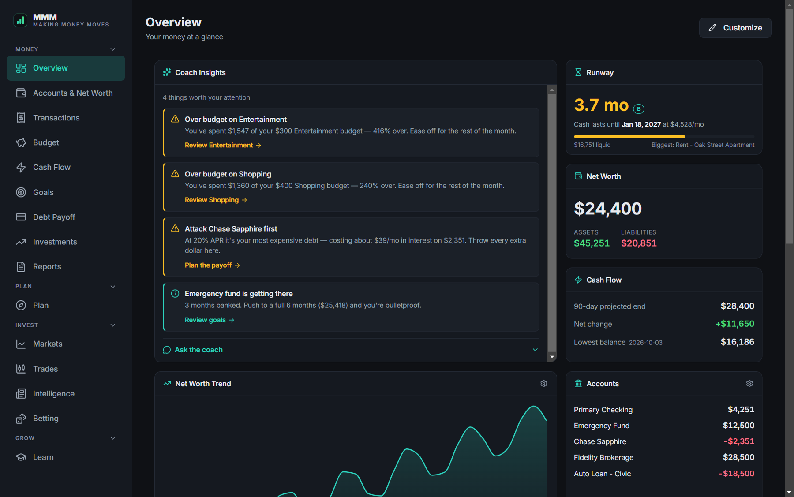
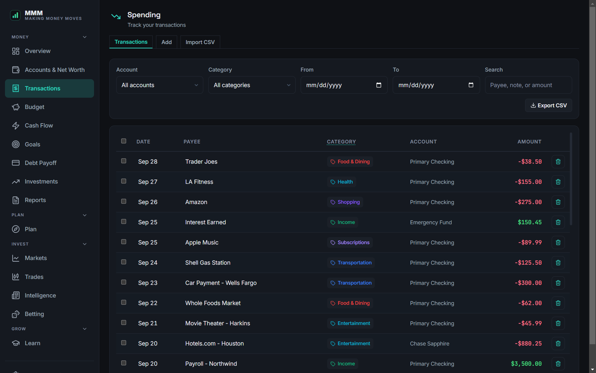
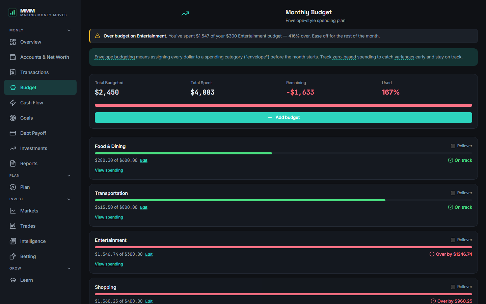
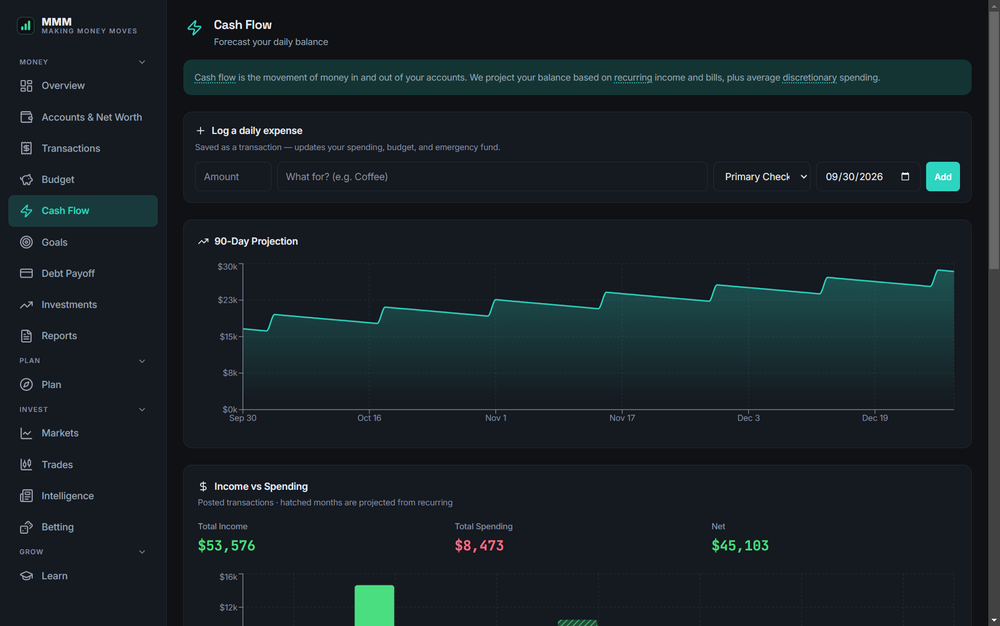
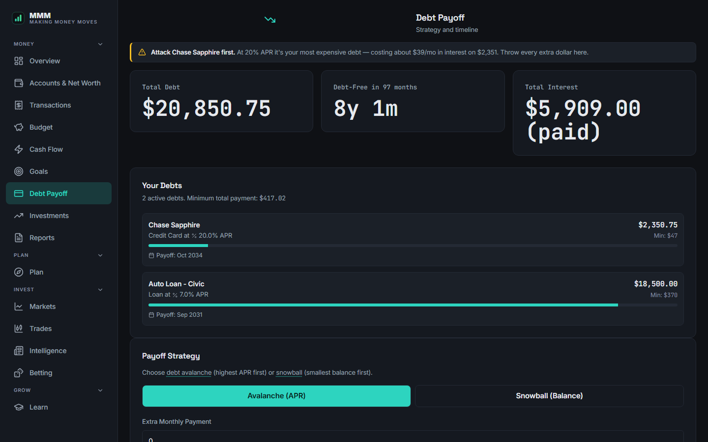
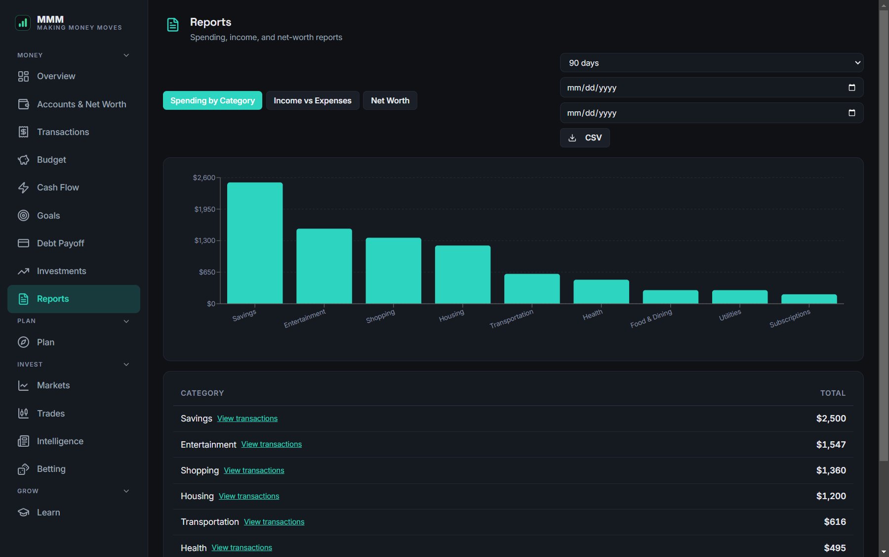
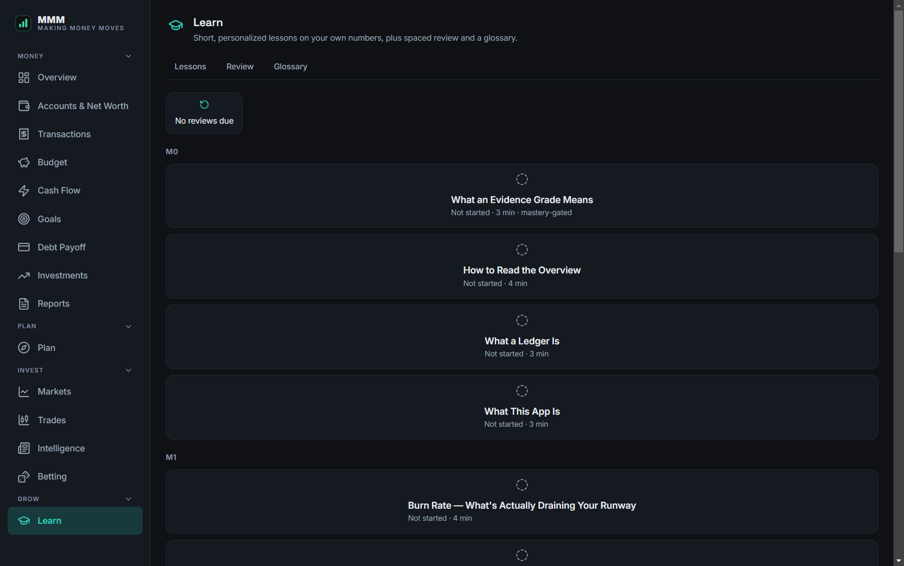
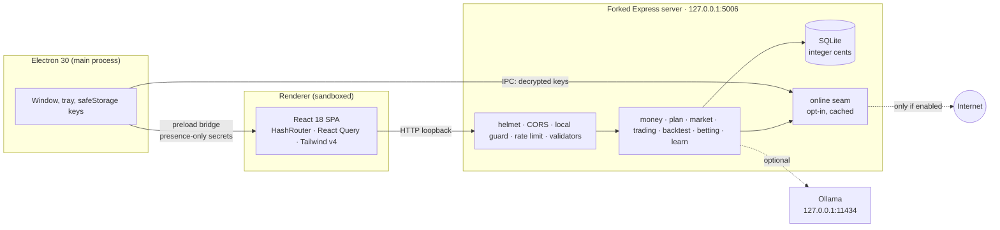

<div align="center">


# MMM — Making Money Moves

**A local-first personal-finance workstation.**
Ledger, budgets, debt payoff, planning, markets, a look-ahead-safe backtester, and a
coach that is never allowed to invent a number. All on your machine.

[](https://github.com/aaronk2001/mmm-app/actions/workflows/ci.yml)
[](LICENSE)


[**Download**](https://github.com/aaronk2001/mmm-app/releases/latest) ·
[Design docs](docs/design/) ·
[Architecture](#architecture) ·
[Contributing](CONTRIBUTING.md)

</div>



| Transactions | Budget | Cash flow |
|---|---|---|
|  |  |  |
| **Debt payoff** | **Reports** | **Learn** |
|  |  |  |

<sub>All screenshots use the built-in sample data and are regenerated with `npm run screenshots`.</sub>

---

## Why this exists

Most budgeting apps want your bank password, sync your transactions to their
servers, and use a language model to tell you things about your money that
nobody checked. MMM takes the opposite position on each point:

| | Typical finance app | MMM |
|---|---|---|
| **Where data lives** | Vendor cloud | One SQLite file in `%APPDATA%\mmm` |
| **Account required** | Yes | No |
| **Network** | Always on | Off. Every online feature is opt-in, default off, and tested to open zero sockets when disabled |
| **Money math** | Floats | Integer cents; balances *derived*, never stored |
| **AI advice** | Model generates the numbers | Rules compute every number; a *local* model may only rephrase them |
| **Evidence** | Implied certainty | Figures carry an evidence grade (A/B/C) based on how much history backs them |

## What's inside

**Money:** accounts and net worth, transactions (CSV / OFX / QIF import, rules,
bulk edit, custom fields), envelope-style budgets with rollover, cash-flow
forecast with recurring detection, goals with pace projection, debt payoff
(avalanche / snowball, interest-saved delta), investments, and reports with CSV export.

**Plan:** take-home pay, *model an offer* (Δ take-home, Δ runway, Δ 18-month
net worth), raises, Roth / FIRE, what-if. Tax tables are labeled with their year.

**Invest:** markets (quotes, charts, sectors, futures, crypto, FX, macro,
screener), paper trading behind a strategy gate, a deterministic backtester
with 15 performance metrics, market news, and a read-only prediction-market
and sportsbook board with correct de-vigging and arbitrage math.

**Research:** Linda, a Buffett/Munger-minded research agent. Ask about a
ticker and she calls up to six tools (quote, five years of financials, key
metrics, company news, web search) and answers with every figure cited back to
the tool result it came from. Year-over-year growth is computed in code, and a
deterministic check flags any figure in the answer that no tool returned. Runs
on local Ollama by default; Claude or any OpenAI-compatible endpoint can be
picked per question once you enable it.

**Grow:** 15 lessons across three modules, personalized with *your* numbers
and scheduled with FSRS spaced repetition.

**Coach:** a deterministic engine of 10 rules produces ranked findings
(emergency fund, runway, savings rate, overspend, high-APR debt, goal pace …).
If [Ollama](https://ollama.com) is running locally, a small model can phrase
them conversationally from a facts block. It cites only numbers the rules
supplied, and the app works identically without it.

## Engineering highlights

Each of these is written up with invariants, code citations, and the tests
that pin it, in [`docs/design/`](docs/design/):

- **[Ledger](docs/design/ledger.md):** integer cents, derived balances,
  idempotent schema migrations, a data-dir guard that refuses to open the
  wrong database, and a strict local-calendar date rule (tests run under
  `TZ=America/Phoenix` to catch UTC-midnight shifts).
- **[Quant](docs/design/quant.md):** strategies see bars through a `Proxy`
  that traps every path to the future (including `ownKeys` and property
  descriptors); runs are hashed for determinism; splits are applied before
  marking so equity is split-invariant. Odds math uses return-on-stake
  `1/Σp − 1` and refuses to score three-way markets as two-way.
- **[Decision support](docs/design/decision-support.md):** runway burn is
  measured over *observed* days on liquid accounts with transfers excluded;
  the LLM grounding contract; evidence grades; FSRS-scheduled lessons.
- **[Privacy & security](docs/design/privacy-and-security.md):** threat
  model, a complete outbound-host inventory, `safeStorage`-encrypted keys the
  renderer can never read, a sandboxed and context-isolated renderer, and a
  loopback guard against DNS rebinding and cross-site writes.

## Quick start

**Use it:** download `MMM-portable-win-x64.zip` from the
[latest release](https://github.com/aaronk2001/mmm-app/releases/latest), unzip, run `MMM.exe`.
No installer. Click **Load Sample Data** to explore, or start empty and add your own.

**Build it** (Node 20+):

```bash
git clone https://github.com/aaronk2001/mmm-app.git
cd mmm-app
npm install
npm run dev                 # Vite (5173) + Electron, hot reload
```

| Command | What it does |
|---|---|
| `npm test` | 704 unit and route tests (vitest) |
| `npm run check:contrast` | WCAG contrast gate over both themes |
| `npm run check:learn-content` | Validates every lesson's front matter, answers, and sources |
| `npm run build` | Builds the SPA into `src/dist` |
| `npm run build:portable` | Assembles `build/MMM-portable/MMM.exe` and smoke-tests it |
| `npm run screenshots` | Regenerates `docs/screenshots/` from sample data (after `build`) |

Run `build` and `build:portable` one at a time (both write `src/dist`), and
close any running `MMM.exe` first.

## Architecture



```
electron.js, preload.js   shell, hardening, tray, key storage bridge
server/
  db/                     schema, migrations, per-row repository (cents ⇄ dollars)
  money/                  calc, parsers, advice rules, runway, coach
  tools/                  loans, take-home, planning
  backtest/               engine, metrics, strategies, worker
  trading/                paper store + strategy gate
  market/ news/ betting/  providers behind server/online/
  online/                 fetch envelope, feature flags, key handling, cache
  learn/                  lessons, variables, FSRS scheduler
src/                      React SPA (sections, widgets, shared primitives)
content/learn/            lesson Markdown + source licences
tests/                    vitest suites
```

## Data and privacy

- **Packaged app:** everything lives in `%APPDATA%\mmm`: the database, daily
  backups (JSON + live SQLite copy, 30-day retention), preferences, and
  `keys.enc`. Rebuilding or replacing the exe never touches it.
- **Dev:** `server/store/money/mmm.db`. The server refuses to start without
  `MMM_DATA_DIR` or `MMM_ALLOW_DEV_DB=1`. `npm run dev` sets the latter. For
  one-off scripts use a throwaway dir: `MMM_DATA_DIR=$(mktemp -d) node script.js`.
- **Online features:** market, news, prediction markets, sports odds, and the
  Research providers (Finnhub, Exa, Financial Datasets) and opt-in cloud models
  (Claude, OpenAI-compatible), each toggled in Settings → Online & Keys, which
  also lists a free option for every key. With every toggle off, all money
  features work fully offline.

## Disclaimer

MMM is educational software, not financial, tax, or investment advice. Tax
tables are for 2024 and labeled as such. Trading is **paper only**; the betting
board is **informational only** and places no wagers. Verify anything important
with a qualified professional.

## Status and roadmap

v1.0 is the first public release. Windows is the packaged target; the code
is cross-platform, but macOS and Linux builds are untested. Planned next:
an upgrade from Electron 30 (end-of-life) to a supported major, import
staging with de-duplication, transfer matching and splits, a bill
calendar, and signed builds. The feature keys `youtube` and `telegram` are
reserved in `server/online/features.js` but have no consumer yet, so
Settings does not show them.

## License

[MIT](LICENSE) © 2026 Aaron Karsten. Third-party licences are listed in
[`THIRD_PARTY_NOTICES.md`](THIRD_PARTY_NOTICES.md); lesson sources and their
licences are in [`content/learn/sources.yaml`](content/learn/sources.yaml).
