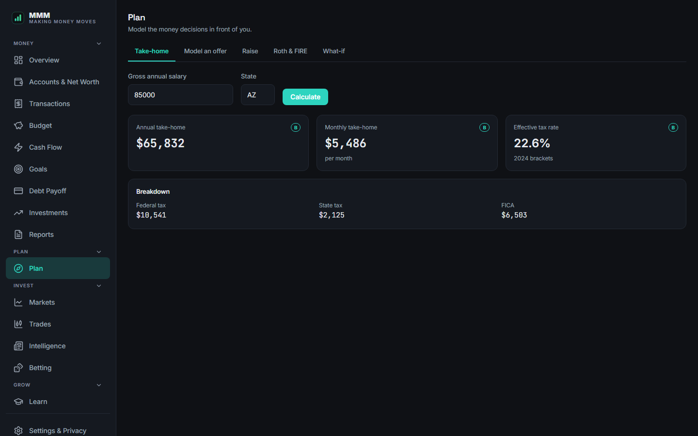

# MMM — Making Money Moves

A standalone, **local-first** personal-finance desktop app. Electron shell → a
local Express server on `:5006` → a React SPA, with all data in a local SQLite
database. No cloud, no accounts, no telemetry by default — every online
feature is an explicit opt-in (see below).


| Budget | Debt Payoff | Plan |
|---|---|---|
|  |  |  |

_Screenshots use the built-in sample data._

## Run it

```bash
npm install
npm run dev              # Vite (5173) + Electron, hot reload
npm start                 # run the Electron shell directly (electron .)
npm test                  # money-math unit tests (vitest)
npm run build              # build the SPA to src/dist
npm run build:portable     # hand-assemble build/MMM-portable/MMM.exe
npm run check:contrast      # WCAG contrast gate over src/styles/theme.css
npm run check:learn-content # validates content/learn/**/*.md (front matter, check answers, sources)
```

**Never run `build` and `build:portable` at the same time.** `build:portable`
runs `vite build` itself as its first step, and both write to `src/dist` — the
loser of the race dies with `EPERM`. Run them one at a time.

**Close any running `MMM.exe` before `npm run build:portable`.** The script
deletes and recreates `build/MMM-portable` (`fs.rmSync` + `fs.mkdirSync` in
`scripts/build-portable.mjs`) — if the portable exe is still running from that
path, Windows holds the file open and the build fails.

`build:portable` ends with its own smoke test (boots the packaged server
against a throwaway data dir and polls `/api/health` + `/api/money/overview`)
and prints `SMOKE PASS — portable ready: build/MMM-portable/MMM.exe`. See also
`docs/SMOKE-CHECKLIST.md` for a manual pass over the packaged exe.

## Where data lives

- **Packaged app:** `%APPDATA%\mmm`. `electron.js` forks the server with
  `MMM_DATA_DIR` set to that path whenever `app.isPackaged` is true, so
  rebuilding or replacing the exe never touches user data.
- **Dev:** the in-repo database at `server/store/money/mmm.db`. `electron.js`
  sets `MMM_ALLOW_DEV_DB=1` itself when launching the server unpackaged (`npm
  run dev` / `npm start`), which is what lets the dev DB load at all.
- **`server/db/connection.js` throws at require-time** unless `MMM_DATA_DIR`
  or `MMM_ALLOW_DEV_DB=1` is set — it no longer falls back to the in-repo dev
  DB silently (that footgun once wiped it via a stray one-off script). For a
  one-off script or ad-hoc `node` invocation against the server code, set a
  throwaway data dir instead of the dev DB opt-in:
  ```bash
  MMM_DATA_DIR=$(mktemp -d) node some-script.js
  ```
- **Backups:** `server/backup/scheduler.js` writes daily JSON + live SQLite
  snapshots to `<DATA_DIR>/backups` (once on startup, then every 24h), keeping
  the newest **30 days** (`RETENTION_DAYS`). Restore on demand from Settings →
  Privacy & Data.

## Online features are opt-in

`server/online/features.js` defines the only feature keys the app knows:
`market`, `news`, `youtube`, `predictionMarkets`, `sportsOdds`, `telegram`,
`cloudLlm`. **All are off by default** — Settings → Online & Keys shows one
toggle + one key field per feature, each starts off, and with zero API keys
configured every money feature (accounts, transactions, budget, cash flow,
goals, debt, investments, reports) still works fully offline.

Keys are stored via Electron's `safeStorage` (encrypted `keys.enc` next to
`desktop-prefs.json` in `%APPDATA%\mmm`, decrypted only in the main process
and pushed to the forked server over IPC — see `server/online/keys.js`).
They're never written to SQLite, `.env`, or localStorage, and the renderer can
only ever read back a presence boolean, never a key value.

Trading (the **Trades** section) is **paper-only** — practice positions
against a strategy gate with zero real money or brokerage connection.

## Deliberately cut

Compared to its sibling project NEXUS, MMM does **not** include: AI/Desk (new
LLM-agent work — the existing local Ollama coach at `/api/money/coach`
remains), Betting/prediction-market trading, Media (news/YouTube feeds beyond
the opt-in toggles), Telegram delivery, and Learn content beyond modules
M0–M2 (`content/learn/m0-orientation`, `m1-runway-survival`,
`m2-cash-flow-steer`). See `docs/NEXUS-PARITY.md` for the full NEXUS-to-MMM
feature mapping.

## Sections

The 14 nav sections (`SECTIONS` in `src/components/money/MoneyHub.jsx`):
Overview, Accounts & Net Worth, Transactions, Budget, Cash Flow, Goals, Debt
Payoff, Investments, Reports, Plan, Markets, Trades, Learn, Settings & Privacy.

## Architecture

- **Frontend:** React 18 + Vite 5, React Router (HashRouter), React Query,
  Tailwind v4 with a semantic token system (`src/styles/theme.css` drives the
  teal-on-charcoal identity; every component reads `--m-*` tokens).
- **Backend:** Express on `127.0.0.1:5006`, helmet + CORS-to-localhost + rate
  limits. Per-row SQLite via `better-sqlite3`; **money is stored as integer
  cents** and account balances are **derived** (opening balance + Σ
  transactions), so there is no float drift and no balance-mutation bugs.
  Hand-rolled request validators guard every write.
- **Shell:** Electron 30 — hardened (`contextIsolation`, `sandbox`, tight CSP),
  forks the server, shows an instant splash, and offers a tray + launch-on-boot.
- **Money math** lives in `server/money/calc.js` (pure, unit-tested); file
  parsing in `server/money/parsers.js` (papaparse CSV, OFX, QIF).

## Packaging

`electron-builder` is blocked on this machine (winCodeSign symlink), so
`scripts/build-portable.mjs` hand-assembles the portable app:

1. `vite build`
2. copy the Electron runtime, rename `electron.exe` → `MMM.exe`
3. inject the app + a **dependency-closure** copy of only the server's runtime
   packages (a full `node_modules` copy times out on the AV-scanned path)
4. swap in the **Electron-ABI** `better-sqlite3` binary via `prebuild-install`
5. stamp the exe icon (`rcedit`, best-effort) and smoke-test the packaged server

The result is `build/MMM-portable/MMM.exe` — no installer required.

## Tech notes

- Bun is not used here — this app is npm + JS/JSX by design.
- Dates are compared as `YYYY-MM-DD` strings on the local calendar throughout
  (never `new Date(isoDate)`, which parses as UTC midnight and can shift the
  displayed day) — see `src/lib/localDate.js` and `server/money/calc.js`'s
  local-date helpers.

## Third-party notices

See `THIRD_PARTY_NOTICES.md` for third-party license attributions.
